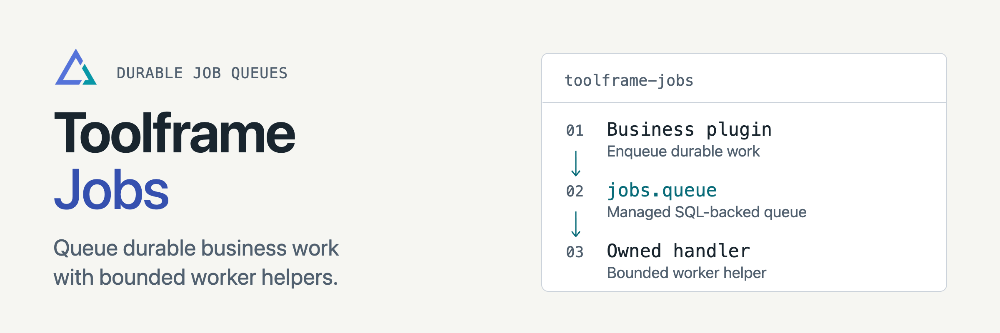

<p align="center">
<picture>
  <source media="(prefers-color-scheme: dark)" srcset="docs/assets/readme-banner-dark.png">
  <source media="(prefers-color-scheme: light)" srcset="docs/assets/readme-banner-light.png">
  
</picture>
</p>

# Toolframe Jobs

[](https://github.com/toolframe/toolframe-jobs/actions/workflows/ci.yml?query=branch%3Amain)

Run durable business work with a managed queue and bounded worker helper.
Each business plugin owns its handlers; Dashboard and read-only MCP tools expose queue state.

## Quick start

In a running [Toolframe application](https://github.com/toolframe/toolframe-core#readme) with an active SQL provider:

```sh
toolframe --home APP plugin add pypi:toolframe-jobs==0.2.1 --enable
```

```sh
toolframe --home APP plugin status jobs --check
```

Use Python 3.14+, Core 0.7+ and SDK 0.4+. Try the
[counter example](examples/durable-counter/README.md) for submit, checkpoint,
stop and resume. Visitors need `jobs.read` or `jobs.cancel`; enqueue and worker
methods are internal plugin dependencies.

**Delivery:** retries default to `never`. Opting into safe retries gives at-least-once
delivery and requires idempotent business effects. Terminal jobs need explicit
retention; interrupted work is not automatically restarted. SQLite is exercised
with real stores; live PostgreSQL is not a validated support claim.

## Guides

| I want to… | Start here |
| --- | --- |
| Integrate a worker safely | [Runner guide](docs/runner.md) |
| Inspect or cancel work | [Usage](src/toolframe_jobs/docs/usage.md) |
| Understand leases and transitions | [Architecture](docs/architecture.md) |
| Contribute or run checks | [Contributing](CONTRIBUTING.md) · [Verification](docs/validation.md) |
| Publish a package | [Releasing](docs/releasing.md) |

[Releases](https://github.com/toolframe/toolframe-jobs/releases)

## License

[Apache 2.0](LICENSE), with [NOTICE](NOTICE).
